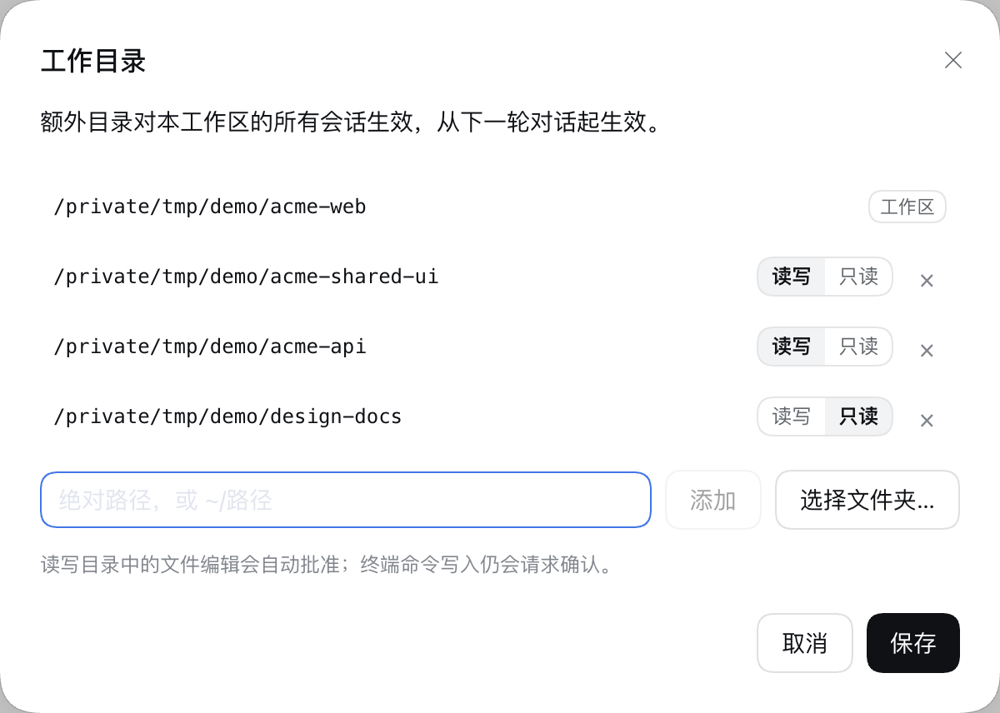
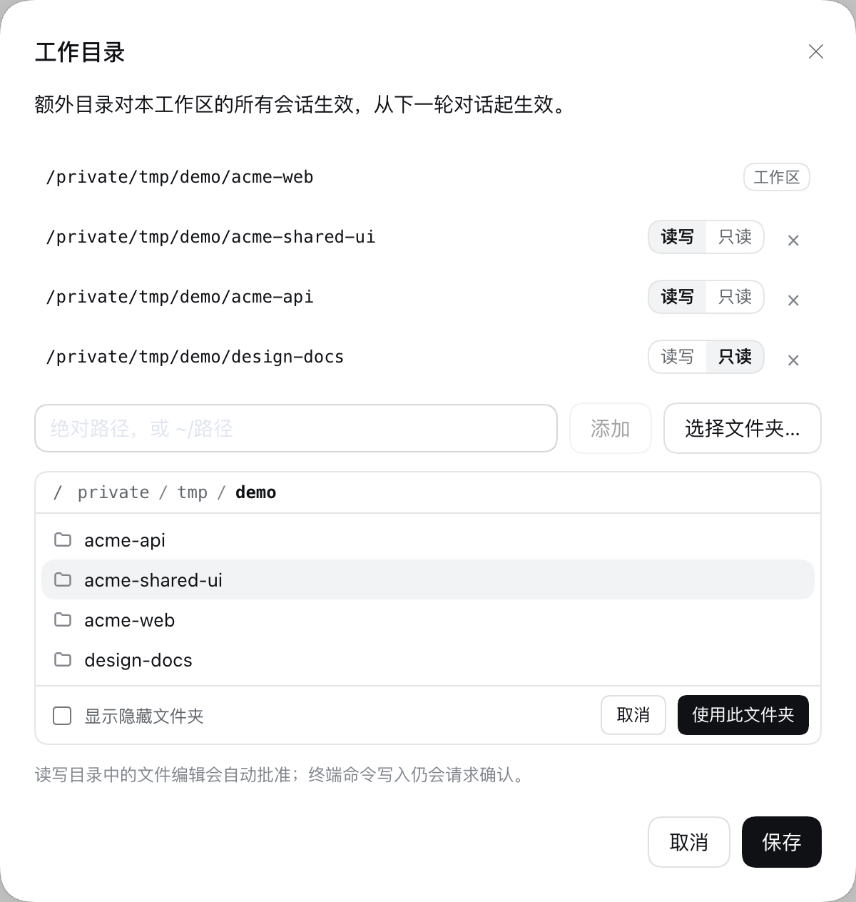
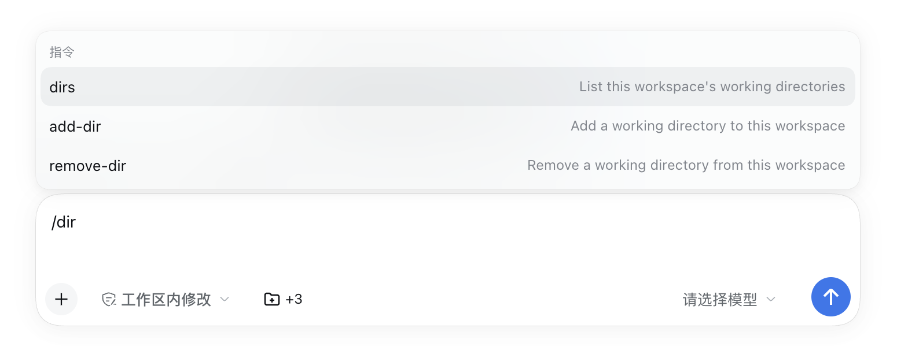

# dsh-workspace-folders

> A DeepSeek Harness (DSH) plugin that gives a workspace **multiple working directories**, like Claude's additional directories: add other folders to a workspace from a composer button or `/add-dir`, and the model can read them and (for read-write folders) edit them with pre-approved sandbox escalation. Works with DSH NEXT, DSH Desktop and `dsh web` on DSH `0.2.1-alpha.5`.

为 DeepSeek Harness（DSH）工作区添加**多个工作目录**的插件，效果类似 Claude 的 additional directories / `/add-dir`：除了工作区本身的目录，还可以把其他目录（例如共享库、文档仓库、另一个前端项目）加入同一个工作区，让模型一起读写。

适配 DSH `0.2.1-alpha.5`（DSH NEXT 2.0.18-next、DSH Desktop Beta）。不修改上游代码，只通过官方扩展点组合：`systemPrompt.context`、`tools/execute`、`approval/request`、`commands`、`connection.fetch`，以及 Web 客户端的 `conversation.input.left` 槽位。

## 截图

输入框旁的「工作目录」按钮显示额外目录数量：


<table>
<tr>
<td width="50%"><br><sub>管理额外目录，切换读写 / 只读</sub></td>
<td width="50%"><br><sub>直接输入路径，或「选择文件夹…」（桌面端为系统对话框，浏览器中为应用内浏览器）</sub></td>
</tr>
</table>

斜杠命令 `/add-dir`、`/remove-dir`、`/dirs`：



## 功能

- **输入框旁的「工作目录」按钮**（📁 +N）：点开后可添加、移除目录，切换「读写 / 只读」。保存后从下一轮对话起生效，本工作区的所有会话共享。
  - 添加目录有两种方式：在输入框里**直接输入**路径（绝对路径或 `~/路径`，回车或点「添加」），或点「**选择文件夹…**」用选择框挑选。
  - 「选择文件夹…」按环境自动选择：在 DSH NEXT / DSH Desktop 窗口里打开系统文件夹对话框（Finder，与添加工作区相同）；在本机 `dsh web` 中由 Host 打开系统对话框；在局域网或远程浏览器中显示应用内文件夹浏览器（从工作区所在目录开始，可点路径跳转、显示隐藏文件夹）。
- **斜杠命令**（任何有命令入口的界面都可用）：
  - `/add-dir <路径> [--read-only]` — 添加目录，支持绝对路径、`~/路径`、相对当前工作目录的路径
  - `/remove-dir <路径>` — 移除目录
  - `/dirs` — 列出当前工作区的全部目录
- **模型可见**：每次请求的运行时上下文（紧跟沙箱策略之后）会列出额外目录及其读写权限；该上下文会写入会话日志，回放时可还原。
- **写入权限**：在默认的 `workspace-write` 沙箱模式下，DSH 只允许修改工作区目录本身。对于标记为「读写」的额外目录，模型使用 `write` / `edit` 工具写入时，插件会自动批准这次沙箱提权（审批记录照常写入会话日志 `approval/asked` / `approval/decided`）。
  - 「只读」目录不会自动批准，写入仍会询问你。
  - 终端命令（bash）写入额外目录仍走正常的提权确认，因为插件无法可靠判断命令会写哪里。
  - 会话处于「只读」模式时不会自动批准任何写入；处于「完全访问」模式时本来就不受限制。
- **全局目录**：可在配置里指定对所有工作区生效的目录。
- **读取额外目录的指令文件**（可选，默认关闭）：开启 `loadInstructions` 后，每个额外目录根部的 `AGENTS.md`（没有时用 `CLAUDE.md`）会作为第二段运行时上下文（紧跟目录列表之后）发给模型，类似 Claude Code 的 `CLAUDE_CODE_ADDITIONAL_DIRECTORIES_CLAUDE_MD`。

## 安装

### DSH NEXT / DSH Desktop

在应用中打开 **DSH 终端**（托盘菜单或设置顶部的终端入口），执行：

```bash
dsh plugin --profile desktop add github:Fleey/dsh-workspace-folders
```

然后完全重启应用（托盘 → **退出并重启**，或设置顶部菜单 → **重启应用**）。输入框工具栏会出现文件夹按钮。

建议固定到某个 commit，避免之后的推送悄悄改变运行的代码：`github:Fleey/dsh-workspace-folders#<commit>`。

卸载：`dsh plugin --profile desktop remove dsh-workspace-folders`，然后重启。

### 普通 `dsh web`

```bash
dsh plugin --profile <你的 profile> add github:Fleey/dsh-workspace-folders
```

### 从本地源码安装（开发用）

```bash
git clone https://github.com/Fleey/dsh-workspace-folders.git
cd dsh-workspace-folders && npm install && npm run build
dsh plugin --profile desktop add link:"$PWD"
```

仓库中已包含构建好的 `lib/`，因此从 GitHub 安装不需要运行构建脚本，也不需要在 profile 中授权 `allowBuilds`。

## 配置

默认配置见 [`cordis.patch.yml`](cordis.patch.yml)。要修改，在 profile 自己的 `cordis.patch.yml`（例如 `~/.dsh/profiles/desktop/cordis.patch.yml`）里覆盖这一行，注意要写全保留的键：

```yaml
- id: workspace-folders
  config:
    autoApproveWrites: true          # 设为 false 则读写目录的每次写入都需要确认
    globalDirectories:               # 对所有工作区生效，~ 会展开为主目录
      - { path: ~/notes, access: read-only }
    # storeFile: /absolute/path.json # 默认 $DSH_HOME/workspace-folders.json
    loadInstructions: false          # 设为 true 则把各额外目录根部的 AGENTS.md / CLAUDE.md 发给模型
    maxInstructionBytes: 32768       # 指令上下文整体（含说明与标题）的 UTF-8 字节上限
```

配置写错（未知键、非绝对路径、非法 access、`maxInstructionBytes` 不是整数或小于截断标记的长度）会在加载时直接报错，而不是被静默忽略。

### 额外目录的指令文件（`loadInstructions`）

- 只看每个额外目录**根部**：优先 `AGENTS.md`；没有可用的 `AGENTS.md` 时才读 `CLAUDE.md`，两者不会同时读取。空白的 `AGENTS.md` 也算「有」，此时不再读 `CLAUDE.md`。
- 读写目录和只读目录都会读取；目录当前不存在、或没有指令文件时直接跳过，不报错。
- 指向目录外部的符号链接（文件本身或其所在路径）一律视为不存在，不会读取；指向目录内部的链接正常读取。非普通文件（目录、FIFO 等）也会跳过。
- 每次组装请求时同步重新读取，所以修改指令文件后从下一次请求起生效；内容变化时会生成新的运行时上下文快照，并像目录列表一样写入会话日志。
- 整段上下文（开头说明、每个目录的标题、正文）合计不超过 `maxInstructionBytes` 字节；超出时在 UTF-8 字符边界处截断，并以 `[Additional-directory instructions truncated here to fit the configured size limit.]` 结尾，后面的目录不再出现。
- 该上下文和目录列表一样是必需上下文（`required`），即使 profile 关闭了可选运行时上下文（`systemPrompt` 的 `includeRuntimeContext: false`）也会保留。

## 数据存储

目录列表按工作区路径保存在 `$DSH_HOME/workspace-folders.json`（默认 `~/.dsh/workspace-folders.json`）：

```json
{
  "version": 1,
  "workspaces": {
    "/path/to/project": {
      "directories": [
        { "path": "/path/to/shared-lib", "access": "read-write" },
        { "path": "/path/to/docs", "access": "read-only" }
      ]
    }
  }
}
```

文件可以手动编辑（改完需重启）。如果文件损坏，插件会拒绝加载并在日志中指出文件路径，而不会用空列表覆盖它。

## 限制

- 额外目录按**工作区**生效（以会话创建时的工作区目录为准），不是单个会话。
- `@` 文件引用补全、技能发现仍只看工作区目录本身；需要时请让模型用绝对路径访问额外目录。
- DSH 自带的 AGENTS.md 读取只看工作区目录。额外目录的指令文件需开启 `loadInstructions`，且只读取额外目录根部的一个文件：子目录中的 `AGENTS.md`、以及 `AGENTS.local.md` / `CLAUDE.local.md` 本地覆盖文件都不会读取；内容放在运行时上下文中，不会像工作区指令那样按目录逐级合并。
- 如果某个额外目录恰好是工作区的上级目录（例如项目根），DSH 自身可能已经读取了它的 `AGENTS.md`，开启 `loadInstructions` 后同一内容会出现两次。
- 只有 `write` / `edit` 工具的写入会被自动批准；终端命令写入需要确认。
- 没有挂载任何目录选择器的组合里不会显示「选择文件夹…」，此时直接输入路径即可。
- 在还没有发送过消息的新会话里执行 `/dirs` 等命令，结果不会显示在空白首页上（命令已执行并记录在会话日志中）；用输入框旁的按钮查看更直观。

## 开发

```bash
npm run typecheck   # TypeScript 检查
npm test            # 单元测试（vitest）
npm run build       # 生成 lib/index.js（Host）与 lib/client.js（Web 客户端）
npm run check       # 以上三项
```

`lib/` 会被提交到仓库（供 `github:` 安装直接使用），修改源码后请运行 `npm run check` 并一起提交 `lib/`。

端到端冒烟测试：用真实的 `dsh --profile headless` 和 DSH 自带的 LLM mock（无需 API key），在临时 `DSH_HOME` 中验证上下文注入、`loadInstructions: true` 时首个模型请求带上额外目录的指令（且默认不带）、读写目录的自动批准、只读目录不批准、以及不装插件时写入被拒绝：

```bash
node scripts/smoke-headless.mts <path-to>/@deepseek-ai/dsh/lib/bin.js <deepseek-harness>/packages/test-support/llm-mock-server/src/index.ts
```

需要 Node ≥ 22.19 和 `zstd` 命令行工具。

### 结构

| 文件 | 作用 |
|---|---|
| `src/index.ts` | 插件入口：挂载上下文、自动批准、命令、路由（所有 Host 服务均为可选） |
| `src/folders.ts` | 生效目录计算、校验、写入授权判断、模型上下文文本 |
| `src/instructions.ts` | 读取额外目录根部的 `AGENTS.md` / `CLAUDE.md`，生成有字节上限的指令上下文 |
| `src/approval.ts` | 跟踪提权的 `write`/`edit` 调用，应答匹配的审批请求 |
| `src/commands.ts` | `/add-dir`、`/remove-dir`、`/dirs` |
| `src/routes.ts` | `/api/workspace-folders/{state,save,pick,browse}` |
| `src/store.ts` | JSON 存储（原子写入、按顺序串行） |
| `src/client/index.tsx` | 输入框按钮与对话框 |

## 许可证

[MIT](LICENSE)
